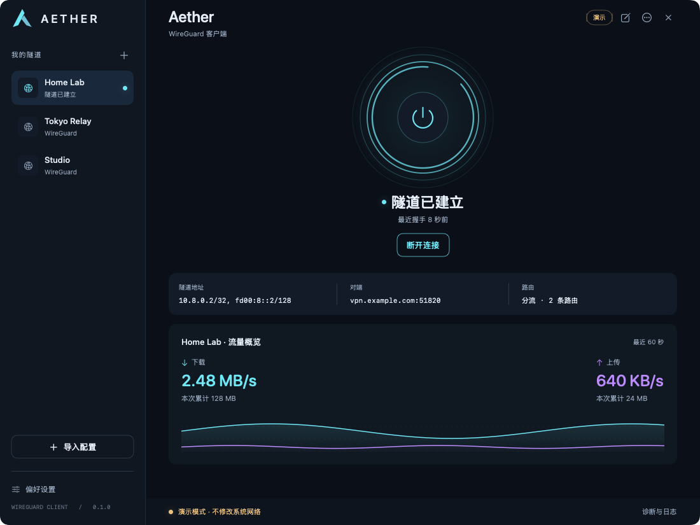
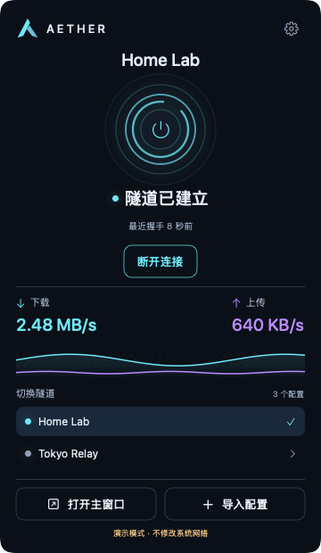
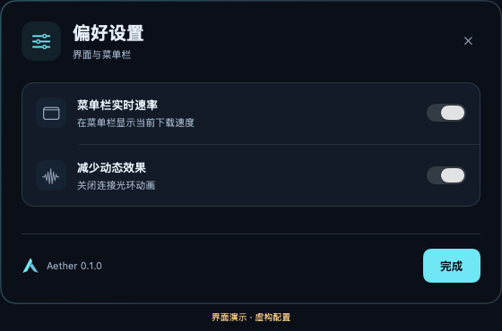

# Aether

A native macOS WireGuard client built with SwiftUI and AppKit. Import your existing WireGuard configuration and manage one active tunnel from a main window or a rich menu bar popover.

[中文文档](README.md) · [Releases](https://github.com/A113n1003/aether-wireguard/releases) · [Contributing](CONTRIBUTING.md) · [Security](SECURITY.md)

**v0.1.0 is a development prerelease.** The distributed app targets Apple Silicon and macOS 14+. It uses ad hoc signing, is not Developer ID signed or notarized, and requires external Homebrew tools. Real network end-to-end validation is still pending.

## Preview

Rendered from the actual SwiftUI views using `--demo` with fictional profiles and simulated traffic. These images do not demonstrate real VPN connectivity.



<p align="center"> </p>

## Features

- Native main window and `NSPopover` share tunnel state, traffic and configuration selection.
- `.conf` import, raw text paste and a single-peer form. Multi-peer/advanced configurations use raw editing.
- Full configurations in local Keychain; only names, IDs and creation dates in the disk index.
- Administrator-authorized connect/disconnect, cancellation, switching confirmation and registered session recovery.
- Handshake timestamps, actual WireGuard counters, 60-second traffic charts and redacted diagnostics.
- Keyboard shortcuts, a compact custom close button and interface preferences.

No account, subscription, application analytics or cloud configuration service. Aether is an independent community project and is not affiliated with WireGuard.

## Install

After installing [Homebrew](https://brew.sh/):

```bash
brew install bash wireguard-tools wireguard-go
```

Download the arm64 zip and `SHA256SUMS` from [Releases](https://github.com/A113n1003/aether-wireguard/releases). Verify them in the same directory:

```bash
shasum -a 256 -c SHA256SUMS
```

Extract the archive, move `Aether.app` into `/Applications`, and import a valid configuration you are authorized to use. macOS requests administrator authorization for tunnel changes.

The current app is not notarized and may be blocked by Gatekeeper. It does not provide Developer ID source authentication; review and build the source if this development distribution model does not meet your needs. Do not globally disable Gatekeeper.

## Build and check

Requires macOS, Swift 6+, the macOS SDK and Python 3. Building and tests do not need the WireGuard runtime, request elevation or change networking.

```bash
git clone https://github.com/A113n1003/aether-wireguard.git
cd aether-wireguard
./Scripts/check.sh
./Scripts/build.sh
open dist/Aether.app
```

```bash
./Scripts/release.sh                          # arm64 zip + SHA256SUMS
dist/Aether.app/Contents/MacOS/Aether --demo   # no real tunnel or config writes
swift test                                  # full Xcode
```

Some Command Line Tools installations lack XCTest/SwiftPM frameworks. `Scripts/check.sh` provides 25 independent assertions, including inert AppleEvent argument handling and authorization cancellation, but does not claim to run XCTest. CI runs both using full Xcode.

## Current limits

One active tunnel; runtime paths fixed to `/opt/homebrew/bin`. Intel runtime support is not validated. No Kill Switch, auto-connect, per-application routing or NetworkExtension. Shell hooks and unsupported `wg-quick` extensions are rejected.

Routing and network-service DNS are delegated to `wg-quick`. Aether does not verify DNS restoration. “Tunnel established” means a handshake timestamp was observed, not continuous end-to-end reachability. Root authorization trusts both the app bundle and the local Homebrew installation.

Real handshake, IPv4/IPv6 routing, DNS restoration and long-running reconnection have not completed end-to-end acceptance testing. See the [architecture](docs/architecture.md) and [roadmap](docs/roadmap.md).

## License

Original source and icon: [MIT](LICENSE). External tools retain their upstream licenses and are not bundled in releases. See [third-party notices](THIRD_PARTY_NOTICES.md).
