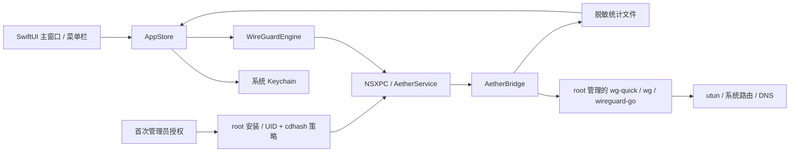

<p align="center">
  
</p>
<h1 align="center">Aether</h1>
<p align="center">macOS 原生 WireGuard 客户端</p>
<p align="center">
  <a href="https://github.com/A113n1003/aether-wireguard/actions/workflows/ci.yml"></a>
  <a href="https://github.com/A113n1003/aether-wireguard/releases"></a>
  
  <a href="LICENSE"></a>
</p>
<p align="center"><a href="README.en.md">English</a> · <a href="https://github.com/A113n1003/aether-wireguard/releases">下载</a> · <a href="docs/architecture.md">架构</a> · <a href="CONTRIBUTING.md">参与贡献</a></p>

Aether 使用 SwiftUI + AppKit，直接导入已有 WireGuard 配置，为主窗口和菜单栏连接面板提供一致的连接状态、隧道切换和流量信息。无需账号或订阅；本应用没有分析遥测或云端配置服务。

> **v0.1.0 为开发预发布。** 安装包仅支持 Apple Silicon / macOS 14+，依赖 Homebrew WireGuard 工具；使用 ad hoc 签名，尚未做 Developer ID 签名或公证。真实网络端到端验收仍待完成。当前发行边界见下文与 [安全政策](SECURITY.md)。

`main` 分支新增一次授权安装的连接服务；此改动尚未发布到 v0.1.0，已完成本机安装、连接 / 断开及客户端重启实测。下载旧 Release 仍可能在连接 / 断开时请求密码。

## 界面预览

以下图片由实际 SwiftUI 组件在 `--demo` 下离屏渲染，使用虚构配置与模拟流量，不代表真实网络已连接。


<p align="center">
  
  
</p>

## 已实现

- **主窗口与菜单栏面板**：原生 `NSPopover`，连接光环、状态、实时流量和隧道列表共享同一数据源。
- **三种配置入口**：导入 `.conf`、粘贴原文、单 Peer 表单。多 Peer / 高级字段使用原文编辑，避免表单丢字段。
- **系统 Keychain**：完整配置存于本机钥匙串，磁盘索引仅含名称、UUID 和创建日期；密钥默认隐藏。
- **隧道生命周期**：首次管理员授权安装连接服务，日常连接 / 断开通过受限后台服务执行；支持取消、配置切换确认与应用重启后的已登记会话恢复。
- **连接信息**：真实 WireGuard 收发计数、握手时间、接口 / 路由 / DNS 摘要、最近 60 秒流量图与脱敏事件日志。
- **桌面交互**：背景拖动、自定义关闭按钮、键盘快捷键；关闭主窗口后隐藏 Dock 图标并保留菜单栏，重新打开主窗口时恢复 Dock 图标。

当前一次管理一个活动隧道。Aether 是独立社区项目，与 WireGuard 官方没有隶属关系。

## 安装

### 运行要求

| 项目 | 要求 |
| --- | --- |
| 系统 | macOS 14 或更新版本 |
| 发行架构 | Apple Silicon (`arm64`) |
| 首次设置 | Apple Command Line Tools 的 `/usr/bin/python3` 和 Homebrew `bash`、`wireguard-tools`、`wireguard-go` |
| 工具路径 | `/opt/homebrew/bin`；当前 Intel Homebrew 路径不受支持 |
| 服务端 | 自己有权使用的有效 WireGuard 配置；Aether 不提供 VPN 服务 |

已安装 [Homebrew](https://brew.sh/) 后，先安装运行时依赖：

```bash
brew install bash wireguard-tools wireguard-go
```

macOS 自带 Bash 3.2 不满足 Darwin `wg-quick` 的要求，因此使用 Homebrew Bash 4+。

### 下载 Release

1. 打开 [Releases](https://github.com/A113n1003/aether-wireguard/releases)，下载 `Aether-v0.1.0-macos-arm64.zip` 和 `SHA256SUMS`。
2. 将两个文件放在同一目录，校验：

   ```bash
   shasum -a 256 -c SHA256SUMS
   ```

3. 解压，将 `Aether.app` 拷贝到 `/Applications`，打开应用。
4. 点击「添加隧道」或「导入配置」，保存自己的配置，再点击连接。
5. v0.1.0 的连接 / 断开由 macOS 请求管理员授权。密码只交给系统，应用不保存密码。

### 源码版首次设置连接服务

首次点击连接会设置本机后台服务，并由 macOS 请求一次管理员授权。应用将本机 Homebrew 工具及必要的 Bash 动态库复制到 root 管理的固定目录；之后连接和断开通过受限 NSXPC 接口执行，无需每次请求密码。服务只接受设置时绑定的用户和该版本 Aether 的代码签名哈希。

更新或重新构建 Aether 后，需要重新授权设置服务。首次安装或更新前，请先断开已有 Aether 隧道；其他 VPN 不受此安装操作影响。设置不保存密码，也不添加 `NOPASSWD` 规则。本机已验证安装、免密码开关及重启后的免密码操作；覆盖范围见 [验证记录](docs/validation.md)。

卸载服务前先断开 Aether 隧道，然后执行：

```bash
sudo /bin/bash /Applications/Aether.app/Contents/Resources/uninstall-helper.sh
```

若应用放在其他目录，替换命令中的应用路径。卸载保留用户配置。

当前安装包未公证，Gatekeeper 可能阻止打开。该发行版不提供通过安全来源验证的 Developer ID 签名；若不接受这一边界，可按下一节审阅并自行构建源码。不要全局关闭 Gatekeeper。

## 从源码构建

需要 Swift 6+、macOS SDK 和 Python 3；可以使用完整 Xcode，或提供相应 Swift/SDK 的 Command Line Tools。构建本身不要求 WireGuard 运行时，不安装依赖、不提权、不修改网络。

```bash
git clone https://github.com/A113n1003/aether-wireguard.git
cd aether-wireguard
./Scripts/check.sh
./Scripts/build.sh
open dist/Aether.app
```

`dist/Aether.app` 是本地 ad hoc 签名应用。版本来自 `VERSION`；`BUILD_NUMBER` 可设置 bundle build number。

```bash
# 生成带 SHA-256 的 Apple Silicon Release 包
./Scripts/release.sh

# 无网络副作用的交互演示，仅用于开发测试
dist/Aether.app/Contents/MacOS/Aether --demo
```

演示模式不创建网卡，不读写真实配置，显示明确演示标记。偏好设置提供「使用隧道 DNS」「菜单栏实时速率」「减少动态效果」，修改自动保存。「使用隧道 DNS」默认关闭，连接时保留系统 DNS；手动开启后才应用配置中的 DNS。连接中修改需重新连接，保存的配置原文不变。

完整 Xcode 下还可运行：

```bash
swift test
```

若本机 CLT 缺少 XCTest 或 SwiftPM `BuildServerProtocol.framework`，使用 `Scripts/check.sh` 执行独立断言，覆盖配置解析 / 规范化 / 脱敏、命令转义、AppleEvent 参数传递与授权取消、统计聚合、会话校验及连接服务的身份约束。独立检查不替代实际执行 XCTest；CI 在完整 Xcode 中同时运行两者。

## 使用与快捷键

`AllowedIPs` 决定进入隧道的目标网段；设置 `0.0.0.0/0` 或 `::/0` 会包含相应默认路由。Aether 不提供按应用分流。支持字段与示例见 [配置说明](docs/configuration.md)。

| 快捷键 | 操作 |
| --- | --- |
| `⌘O` | 导入配置 |
| `⌘D` | 连接 / 断开 |
| `⌘⇧M` | 打开菜单栏连接面板 |
| `⌘1` / `⌘W` | 打开 / 关闭主窗口 |
| `⌘L` | 连接诊断 |
| `⌘,` | 偏好设置 |
| `⌘Q` | 退出；活动隧道可选择断开或保留 |

“等待对端握手”表示接口已启动但未观测到握手。“隧道已建立”表示曾读取到握手时间，**不保证当前端到端可达性**；应结合最近握手时间和流量判断。

## 架构与数据



| 目录 | 内容 |
| --- | --- |
| `Sources/AetherApp` | SwiftUI / AppKit 界面、状态和生命周期 |
| `Sources/AetherCore` | 配置解析、Keychain、后端与统计 |
| `Sources/AetherBridge` | 受限会话操作与后台统计 |
| `Sources/AetherService` | LaunchDaemon、客户端身份校验与固定 NSXPC 接口 |
| `Tests/AetherCoreTests` | XCTest 回归测试 |
| `Scripts` | 无第三方 Swift 包的构建、检查与打包工具 |
| `.github/workflows` | CI、tag 构建与预发布 |
| `docs` | 配置、架构、发布、路线图 |

完整配置保存在 Keychain 的 `io.aether.wireguard` service；用户索引位于 `~/Library/Application Support/Aether/profiles.json`。操作期间 helper 使用权限 `0600` 的配置文件。更多权限、运行目录和所有权约束见 [架构文档](docs/architecture.md)。

## 当前限制

- 未完成真实服务器握手、IPv4/IPv6 路由、DNS 恢复及长期重连的端到端验收。
- 路由与系统网络服务 DNS 委托给 `wg-quick`；Aether 不验证 DNS 恢复完成。
- 首次设置需信任本机应用与 Homebrew 工具来源。安装后的服务和工具由 root 管理；ad hoc 签名哈希绑定具体版本，不提供 Developer ID 来源认证。
- 连接服务绑定一个本机用户和一个应用版本；更新需重新管理员授权，目前没有自动迁移。
- 不包含 Kill Switch、自动连接、按应用分流、DNS 防泄漏保证或独立 NetworkExtension。
- 不执行配置 hooks，拒绝 `PreUp` / `PostUp` / `PreDown` / `PostDown` / `SaveConfig` / `Table` 等扩展。
- 当前只发布 `arm64`，未验收 Intel；没有自动更新器、App Store 发行或安装器。

## 排查问题

| 情况 | 下一步 |
| --- | --- |
| 缺少工具 | 检查 `brew install bash wireguard-tools wireguard-go` 与 `/opt/homebrew/bin` |
| 连接服务无法设置 | 检查 Apple CLT 的 `/usr/bin/python3`，先断开已有 Aether 隧道，再重试设置 |
| 更新后再次授权 | 服务绑定应用版本的 cdhash；重新设置服务后，日常开关继续使用后台服务 |
| 钥匙串不可访问 | 解锁登录钥匙串，查看系统提示后重试 |
| 等待握手 | 检查配置、服务器、UDP 连通和时间；接口启动不等于服务端响应 |
| 配置导入失败 | 查看就地错误；检查必填字段、32 字节 Base64 密钥、CIDR、IPv6 Endpoint 格式及不支持的 hooks |
| 断开未完成 | 查看「诊断与日志」，保留失败状态并重试；不要按接口号删除其他 VPN 的网卡 |
| 普通 Bug | 提交 [Issue](https://github.com/A113n1003/aether-wireguard/issues/new/choose)，只附脱敏信息 |
| 安全问题 | 按 [SECURITY.md](SECURITY.md) 私下报告 |

## 参与与许可证

请先阅读 [贡献指南](CONTRIBUTING.md) 与 [行为准则](CODE_OF_CONDUCT.md)。当前优先补齐真实网络验收、权限边界和发行签名；后续方向见 [路线图](docs/roadmap.md)。

原创源码和图标采用 [MIT](LICENSE)。外部 WireGuard/Bash 工具及其动态库使用各自的许可证，公共 Release 不打包这些程序；首次设置仅在本机复制所需运行时。见 [第三方说明](THIRD_PARTY_NOTICES.md)。
